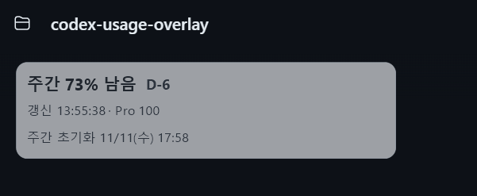
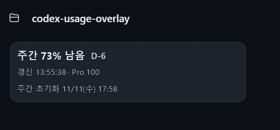
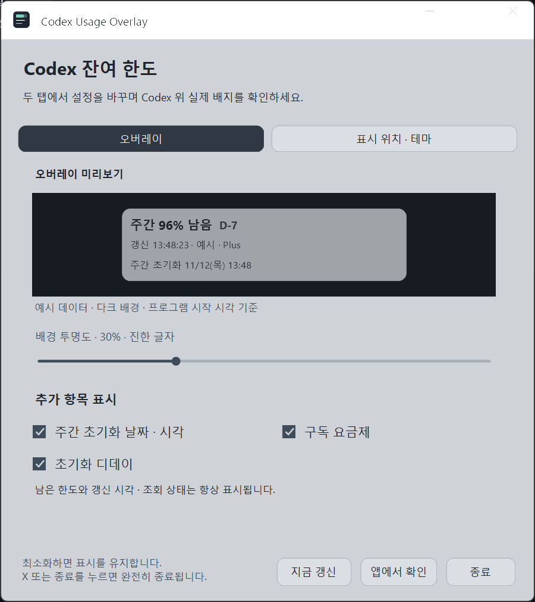
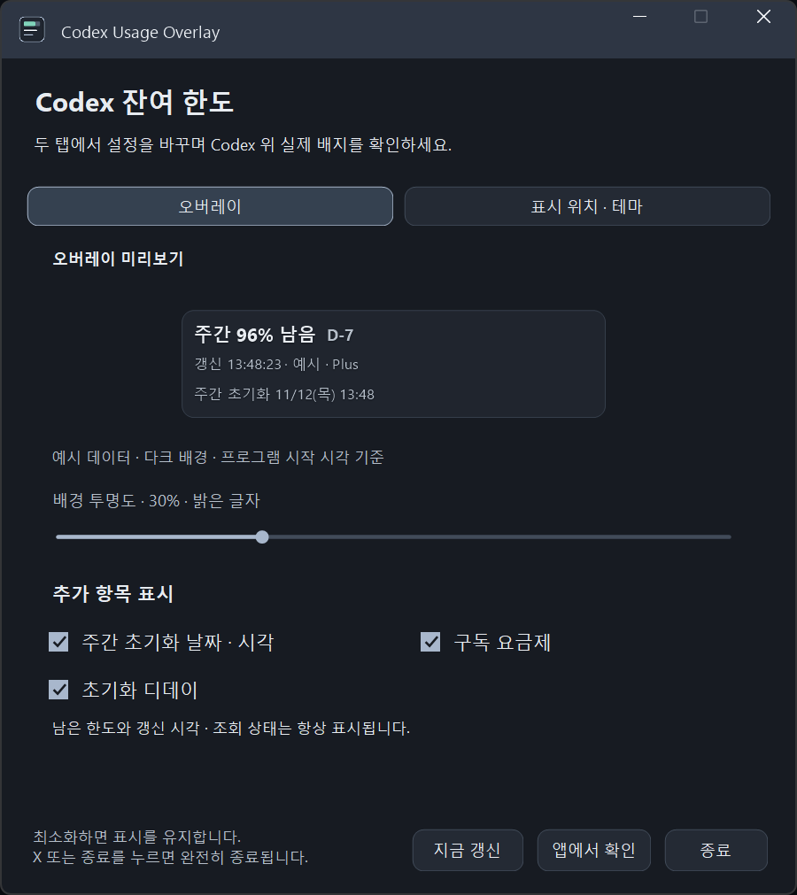
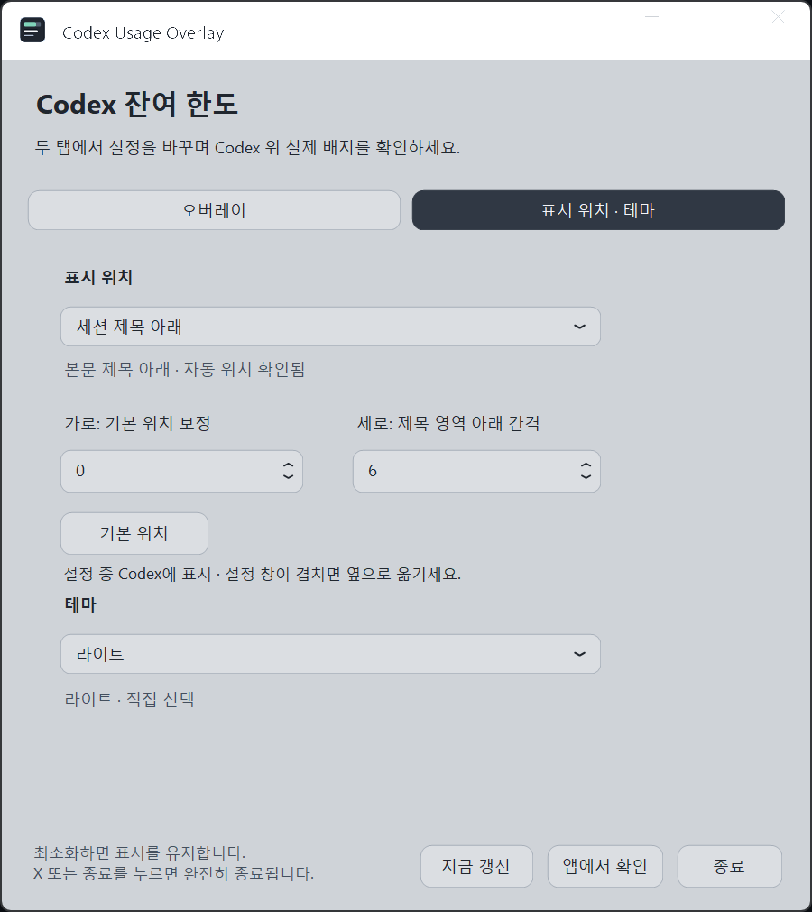
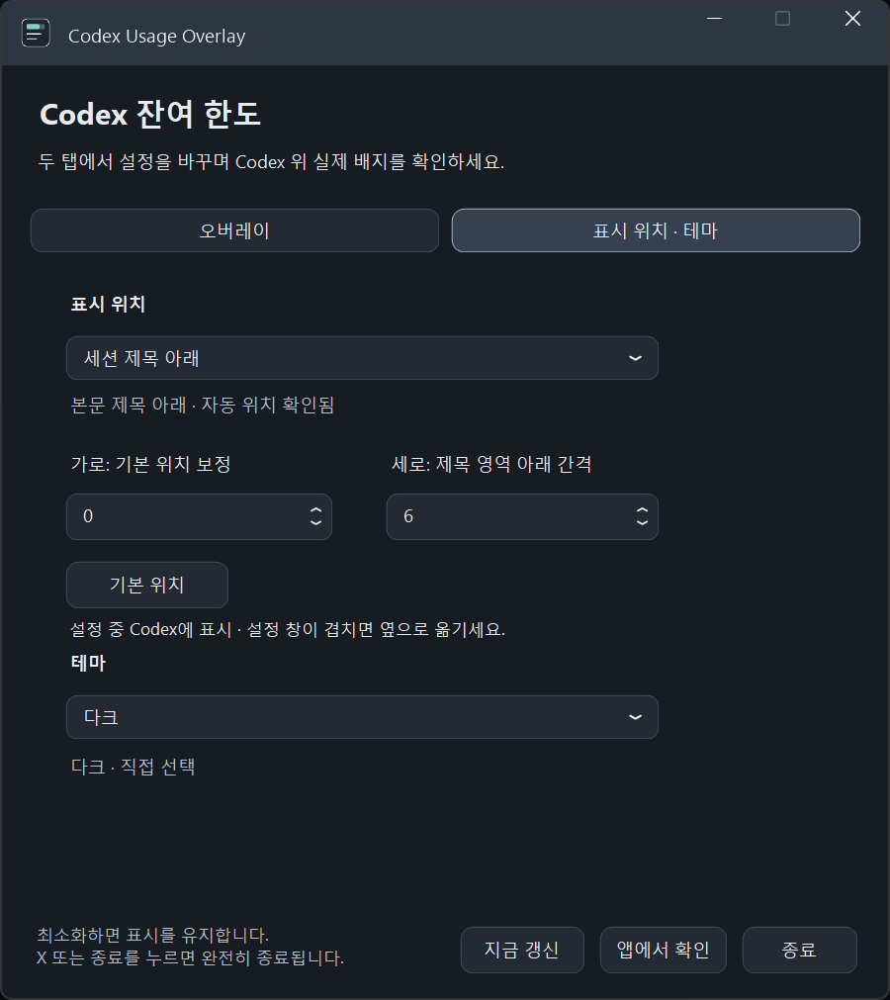

# Codex Usage Overlay

Windows용 Codex 데스크톱 앱 위에 **계정의 남은 사용 한도**를 작게 표시하는 개인용 보조 프로그램입니다. 현재 버전은 **0.6.18**입니다.

문서화된 [Codex App Server](https://learn.chatgpt.com/docs/app-server#6-rate-limits-chatgpt)의 `account/rateLimits/read`를 사용합니다. OpenAI의 공식 제품이나 공식 확장 프로그램은 아닙니다.

| 실제 오버레이 · 라이트 | 실제 오버레이 · 다크 |
| --- | --- |
| <a href="docs/screenshots/overlay-light.png"></a> | <a href="docs/screenshots/overlay-dark.png"></a> |

위 화면은 사용자가 촬영한 특정 시점의 예시입니다. 표시된 **주간 73%·Pro 100**은 현재 계정 상태를 실시간으로 보여 주는 값이 아닙니다.

<details>
<summary>설정 화면 보기 · 두 탭과 라이트/다크 테마</summary>

| 라이트 · 오버레이 | 다크 · 오버레이 |
| --- | --- |
| <a href="docs/screenshots/settings-light-overlay.png"></a> | <a href="docs/screenshots/settings-dark-overlay.png"></a> |

| 라이트 · 표시 위치·테마 | 다크 · 표시 위치·테마 |
| --- | --- |
| <a href="docs/screenshots/settings-light-position-theme.png"></a> | <a href="docs/screenshots/settings-dark-position-theme.png"></a> |

설정 창 안의 **주간 96%·Plus는 고정된 더미 예시**입니다. 실제 계정의 한도나 요금제를 확인한 결과가 아니며 Codex 위에 떠 있는 실제 배지와 데이터가 분리돼 있습니다. 이미지를 누르면 원본을 볼 수 있습니다.

</details>

## 주요 기능

- 실제 세션 제목 아래 또는 사이드바에 표시하고 위치를 보정합니다. 창 위치·크기·화면 배율에 맞춰 배치하며 클릭은 아래 앱으로 통과합니다.
- 계정의 주간·5시간 한도, 마지막 성공 갱신 시각, 구독 요금제와 주간 초기화 날짜·D-day를 표시합니다. 대화 글자 수나 세션 토큰으로 계정 한도를 추정하지 않습니다.
- 조회 중·실패·오래된 값·확인 불가를 구분합니다. 주간 잔여율이 **15% 미만**이면 부족 문구와 색으로, 0%이면 소진 상태로 표시합니다.
- 라이트 **뉴트럴잉크**, 다크 **뉴트럴차콜**, Codex/Windows 테마 따라가기와 배경 투명도 조절을 제공합니다.
- 트레이 없는 일반 창 프로그램입니다. **X 또는 종료 버튼으로 완전히 종료**하며 최소화 중에도 Codex가 활성 상태이면 배지와 조회가 계속됩니다. 자동 시작·예약 작업은 등록하지 않습니다.

## 요구 사항

- Windows 10/11 x64 및 .NET Framework 4.8
- Node.js와 ChatGPT 계정으로 인증된 Codex CLI의 `codex.exe`
- 현재 창 인식 대상: `OpenAI.Codex` MSIX 패키지의 Codex 데스크톱 앱
- 개발 검사에는 Node.js 18 이상 필요

Node와 Codex는 기존 설치를 사용하며 포터블 폴더에 포함되지 않습니다. 프로그램이 실행 구성요소를 자동으로 내려받거나 설치하지 않습니다.

## 포터블 실행과 업데이트

정식 버전 태그의 빌드·검사·출처 증명이 모두 성공하면 [GitHub Releases](https://github.com/JooWon0712/codex-usage-overlay/releases)에 포터블 ZIP을 자동 게시합니다. 공개된 버전과 파일은 Release 목록에서 확인하세요. [Actions](https://github.com/JooWon0712/codex-usage-overlay/actions/workflows/windows-build.yml)의 성공한 실행에서 **Artifacts**를 받거나 아래 개발 절차로 직접 빌드할 수도 있습니다.

Release의 배포 자산은 `codex-usage-overlay-windows-x64.zip`, `SHA256SUMS.txt`, `codex-usage-overlay.intoto.jsonl` 세 개입니다. EXE는 ZIP 안에 포함되며 별도 자산으로 게시하지 않습니다. 전체 ZIP을 풀어 사용하며 Node와 인증된 Codex CLI는 PC에 별도로 준비해야 합니다.

`windows-x64-RUN_NUMBER-RUN_ATTEMPT` 아티팩트에는 전체 포터블 폴더 `codex-usage-overlay/`, 배포 ZIP `codex-usage-overlay-windows-x64.zip`, `SHA256SUMS.txt`가 들어가며 보관 기간은 30일입니다. Actions 화면에서 받는 아티팩트 ZIP은 이 파일들을 담은 포장 파일이며 그 안의 배포 ZIP과 구분합니다. `dist/` 자체는 Git에서 추적하지 않습니다.

1. `codex-usage-overlay-windows-x64.zip`을 원하는 폴더에 압축 해제합니다.
2. 폴더 안의 `UsageOverlay.exe`를 두 번 눌러 실행합니다. 일반 실행에는 인수가 필요하지 않습니다.
3. 업데이트하거나 위치를 옮길 때는 **X로 완전히 종료한 뒤 전체 폴더를 교체하거나 이동**합니다.

`UsageOverlay.exe`, `worker.mjs`, `probe.mjs`, `usage-state.mjs`, `runtime-paths.json`을 같은 폴더에 유지하세요. EXE만 옮기거나 ZIP 안에서 바로 실행하지 않습니다. `Setup.exe`나 설치 스크립트 실행, 고정 경로 설치, 관리자 권한은 필요하지 않습니다.

`runtime-paths.json`은 Node/Codex 실행 파일의 절대 경로 또는 EXE 폴더 기준 상대 경로를 지원합니다. 지정한 실행 파일이 없으면 `PATH`에서 `node.exe`·`codex.exe`를 찾습니다. 다른 PC에서는 그 PC의 Node/Codex 설치·계정 인증·경로 설정이 필요합니다. 경로를 바꾼 뒤에는 X로 종료하고 다시 실행합니다.

설정은 `%LOCALAPPDATA%\CodexUsageOverlay\settings.json`에 저장하므로 폴더를 옮기거나 교체해도 유지됩니다. 여러 사본을 열면 새 인스턴스 대신 기존 설정 창을 복원합니다.

## 설정과 표시 동작

설정 창은 **오버레이**, **표시 위치·테마** 두 탭을 사용합니다.

| 설정 | 동작 |
| --- | --- |
| 구독 요금제 | 기본 켜짐. 갱신 상태·시각 옆에 표시 |
| 주간 초기화 날짜·시각 | 세 번째 줄에 실제 주간 초기화 일정 표시 |
| 초기화 D-day | 첫 줄의 남은 한도 바로 오른쪽에 표시 |
| 배경 투명도 | 0~100%, **10% 단위**. 기본 0%는 불투명 |
| 표시 위치 | 기본 **세션 제목 아래**, 또는 **사이드바** |
| 테마 | Codex 따라가기 / Windows 따라가기 / 라이트 / 다크 |

남은 한도와 갱신 상태·시각은 항상 표시합니다. 100% 투명에서도 글자와 필요한 그림자는 남으며 고대비 모드에서는 가독성을 위해 불투명 배경을 사용합니다. 라이트는 투명도 0~40%에서 어두운 글자, 50~100%에서 밝은 글자로 전환합니다. 설정 변경은 바로 반영하고 약 0.4초 뒤 자동 저장하며 종료 전에도 저장합니다.

설정 미리보기는 시작 시각 기준의 96%·Plus 예시이며 이후 만료되거나 실제 계정 조회 실패 상태로 바뀌지 않습니다. 일반 테마에서는 명시된 다크 예시 배경을 사용하므로 실제 Codex 화면 위 배지와 비쳐 보이는 색이 다를 수 있습니다.

제목 아래에서는 **기본 위치 보정**과 아래 간격을 조절합니다. 기본 가로 위치는 실제 제목 왼쪽에서 30 DIP 왼쪽, 세로는 제목·헤더 아래에서 6 DIP입니다. 사이드바에서는 가로 위치와 배지 아래쪽 기준의 **하단 여백**을 조절합니다.

두 설정 탭 모두 설정 창이 전경이면 Codex 창 위에 **실제 계정 데이터의 배지**를 보여 줍니다. 설정 창이 배지를 덮으면 옆으로 옮겨 확인하세요. **앱에서 확인**은 설정 창을 최소화하고 Codex로 돌아갑니다.

일반 사용에서는 Codex가 전경일 때 표시합니다. Codex가 최소화·숨김 상태이거나 다른 앱이 전경이면 숨깁니다. 설정 창 최소화는 프로그램 종료가 아니며 작업 표시줄에서 복원할 수 있습니다. 제목 표시줄의 전용 앱 아이콘은 시스템 트레이 등록과 관계없습니다.

## 데이터와 갱신 상태

정기 조회는 **Codex가 전경일 때 60초 간격**으로 실행합니다. 설정 중 배지가 보인다는 이유로 추가 조회하지 않으며 수동 갱신은 최소 5초 간격입니다. 마지막 성공으로부터 3분이 지나면 오래된 값으로 구분합니다.

| 상태 | 표시 |
| --- | --- |
| 정상 | 실제 잔여율과 성공 갱신 시각 |
| 조회 중 | 연결 중 또는 갱신 중, 이전 관찰이 있으면 함께 표시 |
| 실패·오래된 값 | 이전 값임을 표시하고 마지막 성공 시각 유지 |
| 성공값 없음 | 확인 불가. 0%나 100%로 대체하지 않음 |

실제 조회 실패 때만 **문제 확인** 버튼을 제공하며 원인·마지막 성공·시도 시각·다음 조치를 펼쳐 볼 수 있습니다. 정상·최초 연결·단순 만료에는 나타나지 않고 복구되면 닫힙니다.

주간 초기화는 공식 응답의 **10080분 한도**에 있는 유효한 초기화 시각을 사용하며 Windows 표시 시간대로 보여 줍니다. D-day는 달력 날짜 차이입니다. 오늘의 미래 시각이면 `D-DAY`, 지난 시각이면 갱신 필요이며 데이터가 없거나 충돌하면 확인 불가입니다. 실패·갱신 중·오래된 값의 일정은 이전 일정으로 구분합니다.

요금제는 같은 공식 응답의 Codex 버킷 `planType`을 사용하며 별도 조회하지 않습니다. Pro 등급 표시명은 다음과 같습니다.

| 응답 값 | 표시명 |
| --- | --- |
| `prolite` | Pro 100 |
| `pro` | Pro 200 |
| `promax` | Pro 500 |

숫자는 등급 표시명이며 원화 결제 금액이 아닙니다. Free·Go·Plus·Team·Business·Enterprise·Edu는 이름으로, 다른 검증된 특수 코드는 `요금제: edu_plus`처럼 표시합니다. 값이 없거나 지원하지 않으면 확인 불가이며 실패·갱신 중·만료에는 `이전 Pro 100`처럼 구분합니다. 계정 변경 알림 때는 이전 한도와 요금제를 지웁니다.

조회 대상은 **연결된 Codex CLI 계정**이며 데스크톱 앱과 같은 계정이라고 보장하지 않습니다. 프로그램이 인증 토큰 파일을 직접 읽거나 복사하지 않고 사용량·계정 식별자를 디스크에 캐시하지 않습니다. 결제 금액·청구 주기·이메일·인증 정보는 표시하지 않으며 대화 생성·모델 추론·한도 초기화 요청도 하지 않습니다.

## 호환성과 제한

- 제목 아래 배치는 Windows UI Automation으로 실제 제목과 헤더를 읽습니다. 현재 `MainTitlebar-`·`ApplicationMenuPageHeader-` 클래스와 `ToolBar` 구조에 의존하므로 Codex 업데이트 후 재검증이 필요합니다. 제목이 없거나 모호하거나 접근성 읽기가 실패하면 숨기고 상태를 표시합니다. 임의 좌표로 대체하지 않으며 사이드바를 선택할 수 있습니다.
- 배지 전체를 넣을 공간이 없으면 `no_space`로 숨깁니다. 실제 혼합 DPI 다중 모니터·가상 데스크톱·계정 전환의 전체 동작은 추가 검증이 필요합니다. 별도 데스크톱 프로세스의 계정 전환을 즉시 감지한다고 보장하지 않습니다.
- Codex 테마 따라가기는 로컬 `config.toml`의 저장 형식에 의존하는 읽기 기능이며 공식 테마 동기화 API가 아닙니다. 읽을 수 없으면 Windows 테마로 대체하며 수동 선택도 제공합니다.
- Codex의 기본 사용량 아이콘 감지와 그에 따른 자동 숨김·이동, 동반 실행 런처, 자동 업데이트, 설치 프로그램은 구현하지 않았습니다. 프로그램이 Codex 파일이나 자동 시작 설정을 변경하지 않습니다.

## 개발과 검증

저장소 루트의 PowerShell에서 실행합니다. `build.ps1`은 Windows의 기존 C# 컴파일러를 사용합니다. 배포용 `-PortableRuntimePaths` 옵션은 `runtime-paths.json`에 `node.exe`·`codex.exe`만 기록하므로 컴파일할 때 Codex 설치나 계정 인증이 필요하지 않습니다. 프로그램을 사용할 때는 요구 사항의 Node/Codex 환경이 필요합니다. 옵션을 생략한 로컬 빌드는 종전처럼 `PATH`에서 찾은 실행 파일의 절대 경로를 기록합니다.

```powershell
.\build.ps1 -PortableRuntimePaths
node --test probe.test.mjs worker.test.mjs tools/release.test.mjs
.\.build\UsageOverlay.exe --self-test .build\geometry-test.json
.\package.test.ps1
.\package.ps1 -PortableRuntimePaths
```

생성 위치는 `.build/UsageOverlay.exe`, `dist/codex-usage-overlay/`, `dist/codex-usage-overlay-windows-x64.zip`입니다. 패키징할 파일이 실행 중이라 잠겨 있으면 교체를 중단합니다. 생성물과 PC별 실행 경로 설정은 Git에서 제외됩니다.

계정 조회 없이 예시 PNG를 만들려면 다음 모드를 사용합니다. 실제 계정·조회 worker·사용자 설정 쓰기를 사용하지 않습니다.

```powershell
.\.build\UsageOverlay.exe --render-samples .build\samples
```

**0.6.18의 C# 자체 검사 501개가 통과**했습니다. Pro 세 표시명, 나머지 요금제 유지와 실패·갱신 중·만료 때의 이전 값 표시를 확인했습니다. 해당 변경에서 Node 검사는 다시 실행하지 않았고 일반 Overlay 실행·실제 계정 조회·새 화면 렌더링도 수행하지 않았습니다. Node 검사 31개 통과와 PNG 384개 렌더링은 **0.6.17의 기록**입니다. 버전별 근거와 실제 확인 범위는 [검증 기록](docs/verification-history.md)에 보존했습니다.

## GitHub 빌드 출처 증명과 릴리스

[워크플로](.github/workflows/windows-build.yml)는 Windows Server 2022·Node.js 24에서 Node 검사, 패키징 검사와 C# 자체 검사를 수행하고 포터블 파일을 빌드하도록 구성돼 있습니다. 실제 계정 조회나 일반 앱 실행은 사용하지 않습니다. 각 실행의 성공 여부와 대상 커밋은 [Actions 결과](https://github.com/JooWon0712/codex-usage-overlay/actions/workflows/windows-build.yml)에서 확인하세요.

| 실행 조건 | 빌드·검사 | EXE·배포 ZIP 출처 증명 | Release 게시 |
| --- | --- | --- | --- |
| `main` 대상 Pull Request | 수행 | 생성하지 않음 | 하지 않음 |
| 이 저장소 `main`의 push 또는 `main`에서 수동 실행 | 수행 | 빌드 성공 후 생성·검증 | 하지 않음 |
| 검증된 정식 버전 태그 push | 수행 | 빌드 성공 후 생성·검증 | 모든 단계 성공 후 게시 |

출처 증명 작업은 같은 실행의 빌드 아티팩트 ID로 파일을 받아 SHA-256을 대조한 뒤 EXE와 배포 ZIP을 증명합니다. 인증서 비밀키나 저장된 인증서 시크릿 대신 GitHub OIDC와 짧은 수명의 Sigstore 자격을 사용합니다. 검증은 저장소·소스 커밋·실제 참조(`main` 또는 버전 태그)·워크플로와 GitHub 호스팅 실행기를 확인하며 증명 번들은 별도 `provenance-RUN_NUMBER-RUN_ATTEMPT` 아티팩트에 30일간 보관합니다.

이 증명은 **어느 GitHub 소스와 워크플로에서 빌드됐는지 확인하는 출처 증명**입니다. Windows Authenticode나 SmartScreen의 신뢰된 게시자 서명이 아닙니다. CI 배포본의 실행 경로 설정에는 PC별 경로 대신 `node.exe`·`codex.exe`만 들어갑니다.

GitHub CLI에서 실행을 조회하고 파일을 받을 수 있습니다. `RUN_ID`, `RUN_NUMBER`, `RUN_ATTEMPT`는 선택한 실행의 실제 값으로 바꿉니다. `gh run download`는 아티팩트 포장을 풀어 `downloaded/`에 파일을 놓습니다.

```powershell
gh workflow view windows-build.yml --repo JooWon0712/codex-usage-overlay
gh run list --workflow windows-build.yml --branch main --repo JooWon0712/codex-usage-overlay
gh run view RUN_ID --repo JooWon0712/codex-usage-overlay
gh run download RUN_ID --repo JooWon0712/codex-usage-overlay -n windows-x64-RUN_NUMBER-RUN_ATTEMPT -D downloaded
```

`main` 실행의 아티팩트에서 받은 배포 ZIP은 다음처럼 검증합니다. 특정 커밋까지 고정하려면 실행에 표시된 전체 커밋 SHA를 `--source-digest COMMIT_SHA`로 추가합니다. 같은 명령에서 파일 경로를 `downloaded/codex-usage-overlay/UsageOverlay.exe`로 바꾸면 EXE도 검증할 수 있습니다.

```powershell
gh attestation verify downloaded/codex-usage-overlay-windows-x64.zip `
  --repo JooWon0712/codex-usage-overlay `
  --signer-workflow JooWon0712/codex-usage-overlay/.github/workflows/windows-build.yml `
  --source-ref refs/heads/main `
  --deny-self-hosted-runners
```

### Release 다운로드와 검증

공개된 태그가 있으면 ZIP·체크섬·증명 번들을 함께 받을 수 있습니다. 아래 `vX.Y.Z`는 실제 공개 태그로, `SOURCE_COMMIT_FROM_RELEASE_NOTES`는 해당 Release 노트의 `Source commit` 전체 SHA로 바꿉니다.

```powershell
$tag = 'vX.Y.Z'
$sourceSha = 'SOURCE_COMMIT_FROM_RELEASE_NOTES'
gh release download $tag --repo JooWon0712/codex-usage-overlay `
  -p codex-usage-overlay-windows-x64.zip -p SHA256SUMS.txt `
  -p codex-usage-overlay.intoto.jsonl -D downloaded
gh attestation verify downloaded/codex-usage-overlay-windows-x64.zip `
  --bundle downloaded/codex-usage-overlay.intoto.jsonl `
  --repo JooWon0712/codex-usage-overlay `
  --source-ref "refs/tags/$tag" --source-digest $sourceSha `
  --signer-workflow JooWon0712/codex-usage-overlay/.github/workflows/windows-build.yml `
  --deny-self-hosted-runners
```

ZIP을 `downloaded/codex-usage-overlay/`에 풀면 같은 증명 번들로 그 안의 `UsageOverlay.exe`도 검증할 수 있습니다. Release 자동 게시는 앱의 자동 업데이트나 로컬 설치를 수행하지 않습니다. 업데이트는 실행 중인 앱을 X로 종료한 뒤 전체 폴더를 교체합니다.

### 버전 태그로 게시하기

태그는 **`vMAJOR.MINOR.PATCH` 정식 버전**만 허용합니다. 태그 `vX.Y.Z`와 `src/Program.cs`의 `AssemblyVersion`·`AssemblyFileVersion`이 모두 `X.Y.Z.0`으로 일치해야 하며 태그 커밋이 `origin/main`에 포함돼 있어야 합니다. `main`의 모든 커밋이 Release가 되는 것은 아니며 **태그 push만** 게시를 시작합니다.

다음 배포를 위한 관리자용 예시는 아래와 같습니다. `vX.Y.Z`를 새 버전의 실제 태그로 바꾸고 소스 버전과 `main` 반영 상태를 확인한 뒤 사용합니다. 이미 존재하는 태그는 재사용하거나 이동하지 않습니다.

```powershell
$tag = 'vX.Y.Z'
git fetch origin
git switch main
git pull --ff-only
git tag -a $tag -m "Codex Usage Overlay $tag"
git push origin $tag
```

게시 작업은 권한이 분리된 별도 job에서 새 draft를 만들고 세 자산을 올린 뒤 자산별 SHA-256·크기와 태그 커밋을 확인한 후 공개합니다. 같은 태그의 Release나 draft가 이미 있으면 중단하며 덮어쓰지 않습니다. 실패 시 미공개 draft가 남을 수 있으므로 재시도 전에 상태를 확인해야 합니다.

자세한 조작 설명은 [사용안내](사용안내.txt), 기본 앱 표시 조사 내용은 [기본 사용량 표시 조사](docs/native-usage-indicator.md)를 참고하세요.
