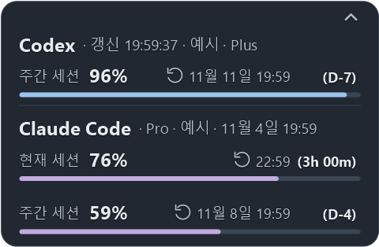
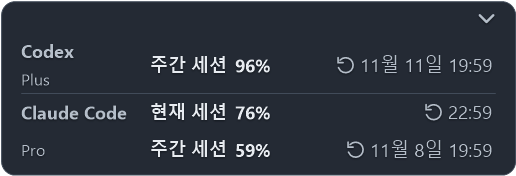
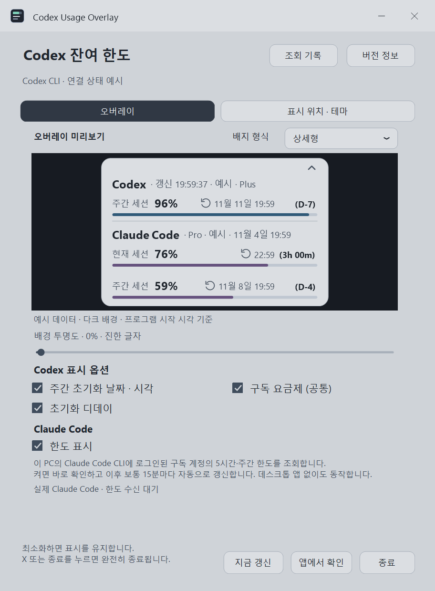
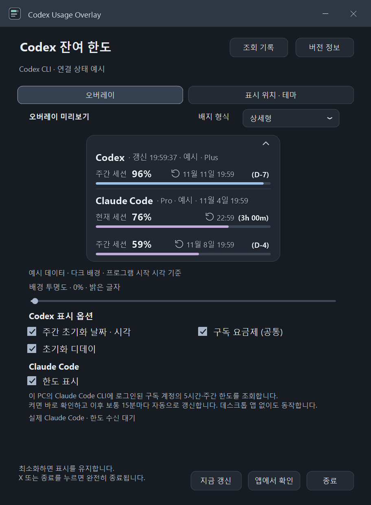
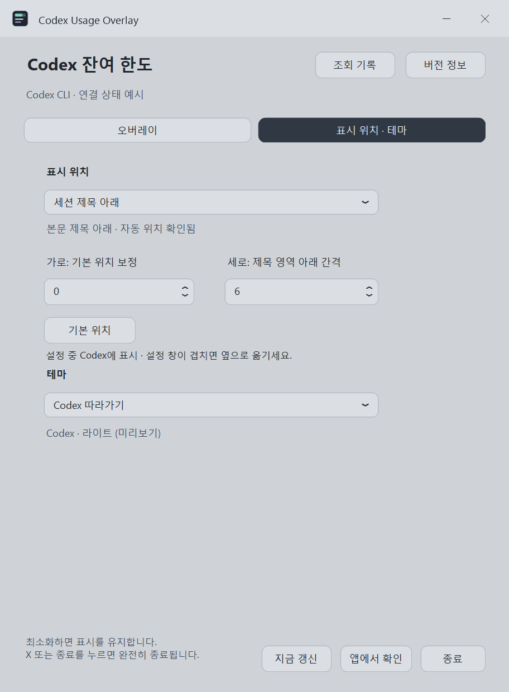
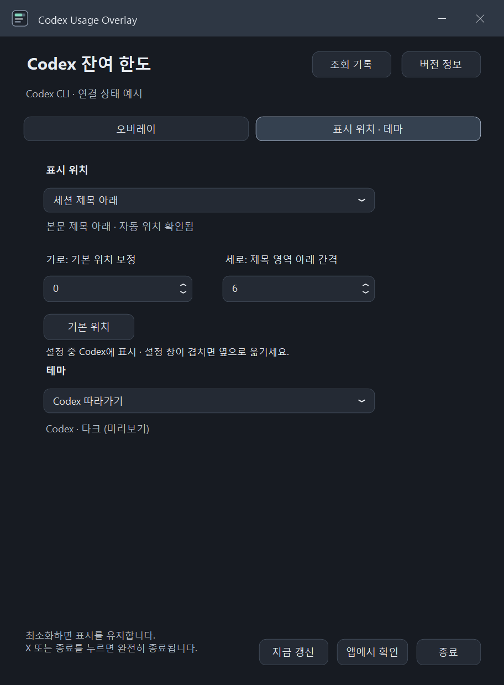

# Codex Usage Overlay

Windows용 Codex 데스크톱 앱 위에서 **계정의 남은 사용 한도**를 보는 포터블 도구입니다. Codex의 주간 한도와 선택한 경우 Claude Code의 5시간·주간 한도를 표시합니다.

[Windows x64 포터블 ZIP 다운로드](https://github.com/JooWon0712/codex-usage-overlay/releases/download/v1.2.0/codex-usage-overlay-windows-x64.zip) · [v1.2.0 릴리스와 검증 파일](https://github.com/JooWon0712/codex-usage-overlay/releases/tag/v1.2.0)

## 미리보기

| 상세형 | 간결형 |
| --- | --- |
| <a href="docs/screenshots/overlay-detailed.png"></a> | <a href="docs/screenshots/overlay-compact.png"></a> |

모든 이미지는 v1.2.0 앱이 예시 데이터로 렌더링한 화면입니다. 이미지를 눌러 원본 크기로 볼 수 있습니다.

<details>
<summary>설정 화면 · 오버레이와 표시 위치·테마</summary>

| 라이트 | 다크 |
| --- | --- |
| <a href="docs/screenshots/settings-light-overlay.png"></a> | <a href="docs/screenshots/settings-dark-overlay.png"></a> |
| <a href="docs/screenshots/settings-light-position-theme.png"></a> | <a href="docs/screenshots/settings-dark-position-theme.png"></a> |

</details>

## 시작하기

**필요한 환경**은 Windows 10 또는 11 x64, .NET Framework 4.8, Node.js, Windows용 Codex 데스크톱 앱입니다. 한도를 조회할 Codex CLI는 ChatGPT 계정으로 로그인돼 있어야 합니다. 프로그램은 먼저 설정과 `PATH`의 `codex.exe`를 찾고, 경로가 없으면 Windows에 등록된 `OpenAI.Codex` 앱 패키지의 실행 파일을 찾습니다. 개발과 CI는 Node.js 24 기준입니다.

1. [GitHub Releases](https://github.com/JooWon0712/codex-usage-overlay/releases)에서 `codex-usage-overlay-windows-x64.zip`을 받아 원하는 폴더에 전부 풉니다.
2. 폴더 안에서 `UsageOverlay.exe`를 실행하고 Codex 창으로 돌아갑니다. 기본 위치는 세션 제목 아래입니다.
3. 설정의 **앱에서 확인**을 누르면 설정 창을 최소화하고 Codex로 돌아갑니다. **X** 또는 **종료**를 누르면 프로그램과 조회를 종료합니다.

ZIP을 푼 폴더를 그대로 사용합니다. 실행 중에는 작업 표시줄에서 설정 창을 복원할 수 있습니다. 여러 사본을 실행하면 기존 설정 창이 복원됩니다.

### 버전 업데이트와 경로 설정

업데이트하거나 폴더를 옮길 때는 먼저 **X**로 종료합니다. 새 버전을 풀어 폴더 전체를 교체하세요. 사용자 설정은 `%LOCALAPPDATA%\CodexUsageOverlay\settings.json`에 저장되어 유지됩니다. `runtime-paths.json`을 직접 수정했다면 그 파일도 새 폴더로 옮깁니다.

`runtime-paths.json`의 `Node`와 `Codex`는 실행 파일의 절대 경로 또는 EXE 폴더 기준 상대 경로를 지원합니다. 각각 지정 경로를 찾을 수 없으면 `PATH`에서 다시 찾습니다. 실행 중 Codex 앱 업데이트로 사용하던 경로가 사라지면 자동 조회 또는 **지금 갱신** 때 새 경로를 확인합니다.

## 배지와 설정

**오버레이** 탭에서 표시 항목을 고르고, **표시 위치·테마** 탭에서 배치와 색을 조정합니다.

| 설정 | 동작 |
| --- | --- |
| 배지 형식 | **상세형**은 행 아래의 잔여율 막대와 초기화 카운트다운을 표시합니다. **간결형**은 한도마다 한 줄에 잔여율과 초기화 시각을 표시합니다. 실제 배지 오른쪽 위 화살표로도 전환할 수 있습니다. |
| 세션 이름 | 두 형식 모두 Codex와 Claude Code의 주간 한도는 **주간 세션**, Claude Code의 5시간 한도는 **현재 세션**으로 표시합니다. |
| 구독 요금제 | 기본 켜짐. 확인된 요금제를 상세형은 서비스 머리글에, 간결형은 서비스 이름 아래에 표시합니다. |
| 주간 초기화 날짜·시각 | Codex 주간 세션의 초기화 일정을 행 오른쪽에 표시합니다. |
| 초기화 D-day | 상세형의 Codex 주간 세션에서 날짜·시각 표시와 별도로 켜고 끌 수 있습니다. |
| Claude Code → 한도 표시 | 기본 꺼짐. 켜면 두 한도를 추가하고 자동 조회를 시작합니다. |
| 표시 위치 | **세션 제목 아래** 또는 **사이드바**를 선택하고 가로·세로 위치를 보정합니다. |
| 테마·투명도 | **Codex 따라가기**, **Windows 따라가기**, **라이트**, **다크**를 지원합니다. 배경 투명도는 0~100%를 10% 단위로 조정합니다. |

초기화 정보는 배지 오른쪽에 정렬합니다. 예를 들어 상세형에서 `11월 25일 17:58 (D-7)`을 표시하고, 오늘 초기화되는 주간 한도는 `D-DAY · 0h 10m`처럼 남은 시간도 보여 줍니다. 긴 초기화 정보는 상세형의 오른쪽에서 두 줄로 표시될 수 있습니다. 초기화 시각을 확인할 수 없으면 조회 상태를 표시합니다.

서비스 아이콘은 Windows에 등록된 데스크톱 앱에서 가져올 수 있을 때 표시합니다. 화살표 영역을 제외한 배지 본문은 클릭을 아래 창으로 통과시킵니다. 설정 창이 전경일 때도 표시할 Codex 창이 있으면 설정 변경 결과를 바로 볼 수 있습니다. 다른 앱이 전경이거나 Codex가 최소화됐을 때는 배지를 숨깁니다.

미리보기는 프로그램 시작 시각을 기준으로 만든 고정 예시입니다. 실제 배지는 해당 계정의 조회 값을 표시합니다. 설정은 변경할 때 자동으로 저장됩니다.

## Claude Code 한도 조회

1. Windows용 Claude Code CLI를 설치하고 Claude 구독 계정으로 로그인합니다. [Windows 설치 안내](https://code.claude.com/docs/en/setup#install-on-native-windows)
2. 오버레이 설정에서 **Claude Code → 한도 표시**를 켭니다. CLI의 구조화된 `/usage`로 **현재 세션**과 **주간 세션**을 조회합니다. v1.2.0의 자동 조회기는 Windows 네이티브 CLI 2.1.273 이상의 2.x 버전을 대상으로 합니다. [Claude Code 사용량 보고서](https://code.claude.com/docs/en/agent-sdk/typescript#sdkusagereport)
3. Claude 항목 아래에서 마지막 갱신 상태나 로그인 안내를 확인합니다. **조회 기록**과 **지금 갱신** 버튼은 Codex 조회에 사용합니다.

기능을 켜면 즉시 확인하고, 일반적으로 조회 완료 후 **15분 뒤** 다시 확인합니다. 오버레이가 실행 중이면 Codex 창 활성 여부와 별개로 동작합니다. 절전 복귀 때 조회 예정 시각이 지났으면 다시 확인하고, 실패가 이어지면 간격을 최대 60분까지 늘립니다. 요금제는 조회 전후의 CLI 인증 상태에서 같은 계정과 같은 값을 확인했을 때 표시합니다.

CLI는 `%USERPROFILE%\.local\bin\claude.exe`와 `PATH`에서 찾습니다. 다른 위치를 사용하려면 환경 변수 `CODEX_USAGE_OVERLAY_CLAUDE`에 Windows용 `claude.exe`의 절대 경로를 지정하세요.

<details>
<summary>Claude 요청 완료 뒤 갱신하기</summary>

비대화형 Claude Code 호출을 자동화하고 있다면 포터블 폴더의 래퍼에 기존 `-p` 또는 `--print` 인수를 넘깁니다.

```powershell
node 'C:\Apps\Codex Usage Overlay\claude-usage-probe.mjs' --run -p '요청 내용'
```

래퍼는 Claude Code 요청의 출력과 종료 코드를 그대로 전달하고, 요청이 끝나면 오버레이에 조회 신호를 보냅니다. Claude 한도 표시가 켜져 있을 때 다음 조회에 반영됩니다.

</details>

<details>
<summary>Claude Desktop 플러그인과 CLI 상태줄로 연동하기</summary>

자동 조회 기록이 아직 없거나 CLI를 찾지 못한 경우에는 기존 연동이 전달한 데이터를 읽을 수 있습니다. 자동 조회는 `claude-usage-auto.json`, 플러그인과 상태줄은 `claude-usage.json`을 `%LOCALAPPDATA%\CodexUsageOverlay`에 기록합니다. 기존 연동 파일을 쓰는 방식은 하나만 선택하세요.

**Claude Desktop Code 탭**에서 받으려면 예제 경로를 실제 포터블 폴더에 맞춘 뒤 동봉 플러그인을 등록합니다.

```powershell
claude plugin marketplace add 'C:\Apps\Codex Usage Overlay\claude-code-overlay' --scope user
claude plugin install usage-overlay-bridge@codex-usage-overlay --scope user
```

Claude Desktop의 새 로컬 Code 세션을 열거나 `/reload-plugins`로 다시 불러옵니다. 이 플러그인은 Claude가 이미 제공한 한도 정보를 전달합니다. v1.2.0 번들은 Windows 네이티브 로컬 Code 세션의 CLI 2.1.286 이상을 대상으로 합니다. 포터블 폴더를 옮기면 기존 마켓플레이스를 제거하고 새 경로로 등록합니다. [Claude Code 플러그인 명령](https://code.claude.com/docs/en/plugins/cli-reference) · [Mods 실행 환경](https://code.claude.com/docs/en/plugins/mods#where-mods-run)

**Claude Code CLI 상태줄**을 사용한다면 `%USERPROFILE%\.claude\settings.json`의 `statusLine`에 동봉한 `claude-statusline.mjs`를 연결합니다. 기존 상태줄이 있으면 기존 출력을 보존하는 방식으로 연결하고, 새 상태줄을 구성하는 경우에는 [사용안내](사용안내.txt)의 Git Bash·PowerShell 예시를 참고하세요. [Claude Code 상태줄 문서](https://code.claude.com/docs/en/statusline)

</details>

## 조회나 배치에 문제가 있을 때

| 증상 | 확인할 곳 |
| --- | --- |
| 배지가 보이지 않음 | Codex 창을 활성화하고 **앱에서 확인**을 눌러 보세요. 제목 아래 배치에서 제목을 읽을 수 없거나 창이 너무 작으면 창을 넓히거나 **사이드바**로 전환합니다. |
| Codex 한도를 확인할 수 없음 | 설정 상단의 **Codex CLI**와 **조회 기록**에서 실행 경로와 최근 결과를 확인합니다. 실패 때 표시되는 **문제 확인**에는 원인과 시각이 표시됩니다. 경로·로그인을 확인한 뒤 **지금 갱신**으로 재시도합니다. |
| Claude Code 한도를 확인할 수 없음 | **한도 표시**가 켜져 있는지 확인합니다. 항목 아래에 **CLI 확인 불가** 또는 **로그인 필요**가 표시되면 설치 경로와 구독 로그인을 확인합니다. |
| 배지의 색이 기대와 다름 | **표시 위치·테마**에서 테마를 직접 선택할 수 있습니다. Codex 테마 설정을 읽을 수 없으면 Windows 테마를 사용합니다. |
| 표시된 계정이나 요금제가 예상과 다름 | 오버레이는 연결된 CLI 계정의 한도를 표시합니다. Codex 데스크톱과 CLI에서 사용하는 ChatGPT 계정을 확인하세요. |

Codex는 전경에서 60초 간격으로 조회합니다. 마지막 성공 후 3분이 지나면 이전 값으로 표시합니다. 조회 중, 실패, 이전 값, 확인 불가를 구분하고, 주간 잔여율이 **15% 미만**이면 부족을, **0%**이면 소진을 표시합니다. 조회 기록에는 이번 실행에서 완료한 최근 30건의 Codex 조회가 쌓입니다.

제목 아래 배치는 Windows 접근성에서 읽을 수 있는 세션 제목이나 제목 메뉴를 기준으로 합니다. Codex 앱 업데이트로 접근성 구조가 달라지면 배치에 영향을 줄 수 있습니다. [Codex 기본 사용량 표시 조사](docs/native-usage-indicator.md)

## 사용량 데이터

Codex의 계정 한도는 `account/rateLimits/read`로 조회합니다. 주간 초기화는 응답에서 확인된 10080분 한도의 초기화 시각을 사용합니다. [Codex App Server 계정 한도 문서](https://learn.chatgpt.com/docs/app-server#6-rate-limits-chatgpt)

Codex의 `planType` 값 `prolite`, `pro`, `promax`는 각각 **Pro 100**, **Pro 200**, **Pro 500**으로 표시합니다. 숫자는 배지에 쓰는 등급 이름입니다. 계정 변경 알림을 받으면 이전 Codex 한도와 요금제를 지웁니다.

화면 표시 설정과 Claude 조회 결과는 Windows 사용자 데이터 폴더에 저장합니다. Claude 자동 조회 기록에는 사용률·초기화 시각, 갱신 상태와 계정 변경 확인용 해시가 들어갑니다. Codex의 조회 기록은 프로그램이 실행되는 동안 메모리에 보관합니다.

## 개발과 검증

저장소 루트의 PowerShell에서 실행합니다. `-PortableRuntimePaths`는 배포용 실행 경로를 파일 이름으로 기록합니다. 개발 검사와 화면 렌더링에는 예시 데이터를 사용합니다.

```powershell
.\build.ps1 -PortableRuntimePaths
node --check claude-code-overlay/hooks/register.js
node --test probe.test.mjs worker.test.mjs claude-statusline.test.mjs claude-usage-probe.test.mjs tools/release.test.mjs
.\package.test.ps1

$exe = Join-Path $PWD '.build\UsageOverlay.exe'
$report = Join-Path $PWD '.build\self-test.json'
$run = Start-Process -FilePath $exe -ArgumentList @('--self-test', ('"{0}"' -f $report)) -WindowStyle Hidden -Wait -PassThru
if ($run.ExitCode -ne 0) { throw "자체 검사 실패 ($($run.ExitCode))" }
```

포터블 배포물이 필요할 때 `.\package.ps1 -PortableRuntimePaths`를 실행하면 `dist\codex-usage-overlay\`와 배포 ZIP을 생성합니다. 대상 폴더의 EXE가 실행 중이면 교체를 중단합니다. 예시 PNG는 `.\.build\UsageOverlay.exe --render-samples .build\samples`로 생성합니다.

v1.2.0 준비 과정에서 **자체 검사 662개, Node 검사 60개, 패키징 검사 25개**가 통과했습니다. GitHub에서는 Windows Server 2022와 Node.js 24로 빌드한 뒤 출처 증명을 생성하고 검증했습니다. [v1.2.0 Actions 실행](https://github.com/JooWon0712/codex-usage-overlay/actions/runs/44315586220) · [이전 버전 검증 기록](docs/verification-history.md)

## 릴리스 파일 검증

[GitHub Releases](https://github.com/JooWon0712/codex-usage-overlay/releases)에서 포터블 ZIP, `SHA256SUMS.txt`, `codex-usage-overlay.intoto.jsonl`을 받을 수 있습니다. 체크섬으로 파일 일치 여부를 확인하고, GitHub CLI로 ZIP과 내부 EXE가 어느 태그·커밋·워크플로에서 빌드됐는지 검증할 수 있습니다. Windows의 Authenticode 서명과 별도로 확인하는 빌드 출처 증명입니다. [GitHub 출처 증명 문서](https://docs.github.com/en/actions/how-tos/secure-your-work/use-artifact-attestations/use-artifact-attestations)

<details>
<summary>v1.2.0 ZIP 체크섬과 출처 증명 확인 명령</summary>

```powershell
$repo = 'JooWon0712/codex-usage-overlay'
$tag = 'v1.2.0'
$sourceSha = 'be35cf7275ac1b5878b42761d17a9abb40aaacfe'
$zipName = 'codex-usage-overlay-windows-x64.zip'
$bundle = 'codex-usage-overlay.intoto.jsonl'
$output = 'downloaded-v1.2.0'

gh release download $tag --repo $repo -p $zipName -p SHA256SUMS.txt -p $bundle -D $output
if ($LASTEXITCODE -ne 0) { throw '릴리스 파일 다운로드 실패' }

$zip = Join-Path $output $zipName
$actual = (Get-FileHash -LiteralPath $zip -Algorithm SHA256).Hash.ToLowerInvariant()
$checksums = Get-Content -LiteralPath (Join-Path $output 'SHA256SUMS.txt')
if ("$actual  $zipName" -cnotin $checksums) { throw 'ZIP 체크섬 불일치' }

gh attestation verify $zip --bundle (Join-Path $output $bundle) --repo $repo `
  --source-ref "refs/tags/$tag" --source-digest $sourceSha `
  --signer-workflow "$repo/.github/workflows/windows-build.yml" --deny-self-hosted-runners
if ($LASTEXITCODE -ne 0) { throw 'ZIP 출처 증명 검증 실패' }
```

ZIP을 푼 뒤 위 검증의 파일 경로를 `UsageOverlay.exe`로 바꾸면 같은 증명 번들로 EXE도 확인할 수 있습니다. 체크섬 목록에서 EXE의 항목은 `codex-usage-overlay/UsageOverlay.exe`입니다. 다른 버전에서는 해당 릴리스의 태그와 **Source commit** 전체 SHA를 사용하세요.

</details>

### 릴리스 게시

[Windows 빌드 워크플로](.github/workflows/windows-build.yml)는 PR에서 빌드와 검사, 이 저장소의 `main` 푸시에서 추가로 출처 증명을 수행합니다. 공개 릴리스는 정식 버전 태그 푸시로 시작합니다.

1. `src/Program.cs`의 어셈블리 버전과 파일 버전을 모두 `X.Y.Z.0`으로 맞추고 검사합니다. 버전 정보를 `src/PortableReleaseInfo.cs`와 사용자 문서에도 반영합니다.
2. 변경을 커밋해 `main`에 먼저 푸시합니다. 검증한 커밋에 새 `vX.Y.Z` 태그를 만들어 푸시합니다.
3. [GitHub Actions](https://github.com/JooWon0712/codex-usage-overlay/actions/workflows/windows-build.yml)에서 빌드, 출처 증명, 게시 작업을 확인합니다. 게시 작업은 새 초안의 ZIP·체크섬·증명 파일과 태그 커밋을 검증한 뒤 공개합니다.

사용 방법과 선택 연동의 세부 설정은 [사용안내](사용안내.txt)에서 볼 수 있습니다.
